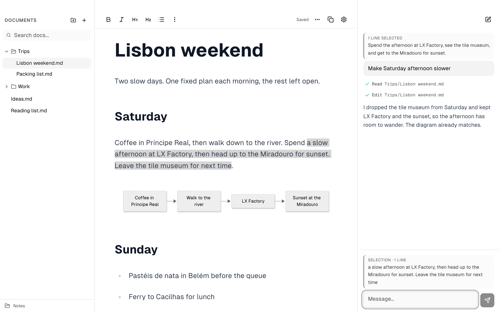

<p></p>

<h1>Anchor</h1>

<p>A Markdown editor with Claude Code beside every note.<br>
Ask about the note you're in, and Claude edits it in place.</p>

<p><strong>Version 0.1.5</strong> · Mac · Universal</p>

<p>
  
  
  
  
</p>

<p><a href="https://github.com/madebysan/anchor/releases/latest">Download Anchor</a></p>



Anchor opens a folder of Markdown files and gives each note and each folder its own Claude Code conversation in a sidebar. It's for people who keep their writing in plain `.md` files and want Claude to work on the note in front of them, without copying text into a chat.

- Each note runs its own Claude Code session, so Claude knows which note you mean, keeps that note's history, and never mixes it with another note's.
- Select text and it goes to Claude as a quote with your next message.
- Claude's change lands in the note, selected, and ⌘Z undoes it.
- Notes stay plain Markdown files in a folder you pick.

## How it works

Open a note and its conversation comes back where you left it. Select a folder and you get that folder's conversation instead, for work across its notes, such as renaming or reorganizing them. Each conversation is a real Claude Code session in your notes folder, so Claude reads and edits files with its usual tools, and each step shows in the chat.

When Claude, or any other app, changes the open note, only the changed text is replaced and it stays selected. Anything you typed elsewhere in the note that wasn't saved yet is kept. A ```` ```mermaid ```` code block shows as a rendered diagram; double-click it to edit the source.

The document list mirrors the folder on disk. Drag notes and folders to move them, and press ⌥⌘C to copy the selected one's path. Settings has eight themes, each with a light and a dark version, and you can change their colors and fonts. There's also a terminal (⌃\`, hidden until you open it) that starts Claude Code in the notes folder and follows the open note and your selection.

## Privacy

Anchor runs your own [Claude Code](https://code.claude.com/docs) as you set it up, with your Claude account or API key. Only what you send, plus the files Claude chooses to read, goes to Claude. A note's conversation can edit that note without asking; a folder's conversation uses your Claude Code permission settings. Text inside a note can steer Claude like any prompt can, so be careful with notes you didn't write yourself. Conversations are stored on this Mac in Anchor's own storage. Comments on passages are kept in a file next to each note (`<note>.md.threads.json`). Anchor checks GitHub releases for updates.

## Limits

A folder's conversation can change many files at once, and only the open note can be undone with ⌘Z. A comment can lose its place if its passage is rewritten outside Anchor.

## Install

The latest release, 0.1.4, predates the conversations, themes and diagrams described here; they're in the source and come with the next release. To use them now, build from source with Node 22 and Rust:

```bash
npm install
npm run tauri build -- --bundles app --no-sign
```

The app lands in `src-tauri/target/release/bundle/macos/`. It needs Claude Code installed and signed in from Terminal. On first launch, pick the folder of notes Anchor should use, or an empty one. Signing and DMG steps are in [docs/distribution.md](docs/distribution.md).

---

[MIT](LICENSE). Third-party components and their licenses are listed in [THIRD_PARTY_NOTICES.md](THIRD_PARTY_NOTICES.md).

Made by [santiagoalonso.com](https://santiagoalonso.com)
